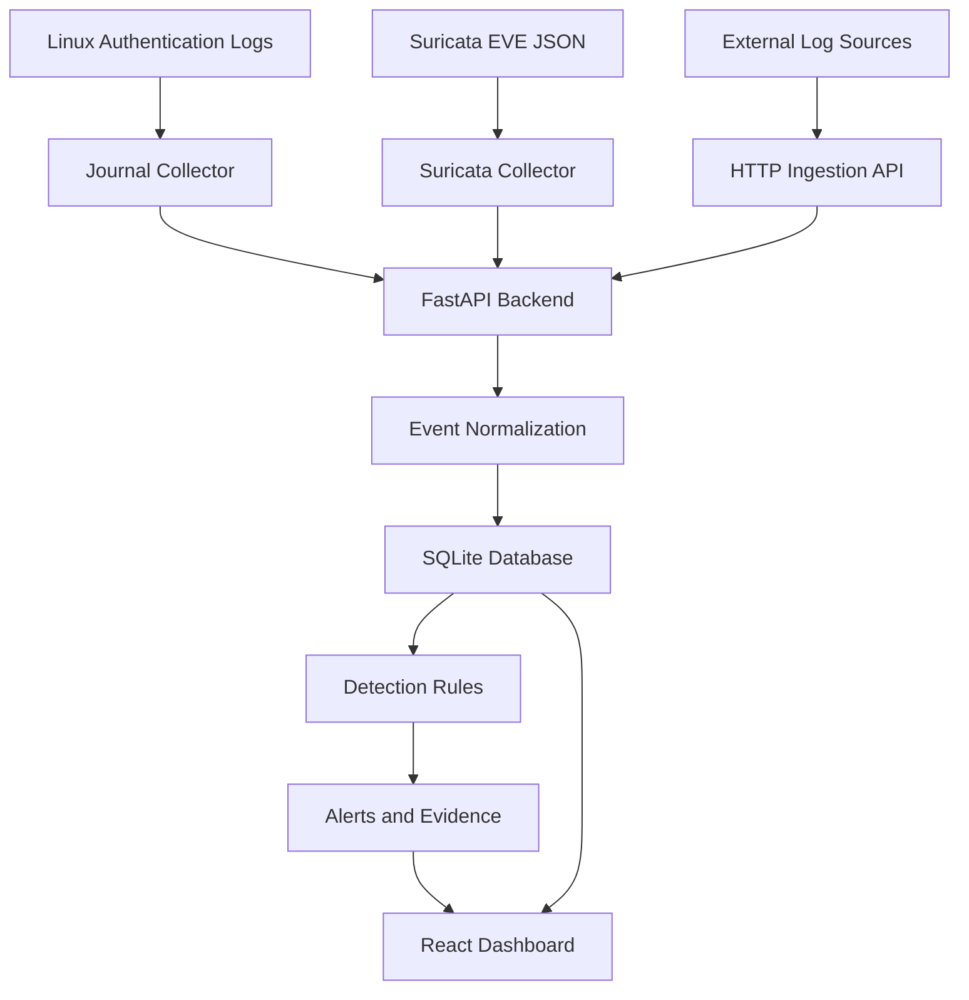

# Greywatch

**An open-source SIEM for Linux security monitoring and threat investigation.**

Greywatch collects security events, detects suspicious activity, and helps investigate potential threats through a unified dashboard. Built with Python, FastAPI, SQLite, and React, it aims to make security monitoring more accessible.

**Status:** Active development. Not yet production-ready.

## Installation

### Prerequisites

- Linux (Fedora or another compatible distribution)
- Python 3 and pip
- Node.js and npm
- Git

### 1. Clone the repository

```bash
git clone https://github.com/AnuragR3k/greywatch.git
cd greywatch
```

### 2. Set up the backend

Create and activate a Python virtual environment:

```bash
python3 -m venv .venv
source .venv/bin/activate
python -m pip install --upgrade pip
```

Install the backend dependencies using the dependency file and instructions provided in the repository.

### 3. Start the backend API

From the repository root:

```bash
uvicorn backend.app.main:app --host 127.0.0.1 --port 8000
```

Verify that the API is running:

```bash
curl http://127.0.0.1:8000/health
```

Expected response:

```json
{
  "status": "ok",
  "service": "greywatch-api",
  "version": "0.1.0"
}
```

### 4. Set up and start the frontend

Open a second terminal:

```bash
cd greywatch/frontend
npm install
npm run dev
```

Open the local URL printed by Vite in your browser.

### 5. Stop the application

Press `Ctrl+C` in each terminal running the backend or frontend.

**Note:** Check the repository's current dependency configuration for the exact backend installation command. Greywatch is under active development, so setup instructions may change.

## Features

- **HTTP event ingestion:** Accept log lines through the API and normalize supported events.
- **SSH brute-force detection:** Detect repeated failed SSH login attempts and generate alerts.
- **Alert investigation:** Review severity, source IPs, event evidence, and raw log messages.
- **Alert resolution:** Investigate and resolve alerts through the dashboard.
- **Linux journal collector:** Optionally collect PAM, SSH, and sudo authentication events from systemd journals.
- **Suricata integration:** Optionally ingest supported EVE JSON events, including alerts, DNS, HTTP, TLS, and flow telemetry.
- **Event search:** Search and inspect collected security events.
- **Security controls:** Protect non-public API endpoints using loopback restrictions or API-token authentication.
- **Automated checks:** Backend tests, frontend linting, and production builds.

## Architecture



## Technology Stack

| Component | Technology |
|---|---|
| Backend | Python, FastAPI, Uvicorn |
| Database | SQLite |
| Frontend | React, Vite |
| Linux telemetry | systemd journal |
| Network telemetry | Suricata EVE JSON |
| Testing | pytest, frontend lint and build |
| CI | GitHub Actions |

## Collectors

### Linux systemd journal

Greywatch includes an optional collector for authentication-related events from the systemd journal, including PAM, SSH, and sudo activity.

The collector is disabled by default.

Documentation: [Journal Collector](docs/JOURNAL_COLLECTOR.md)

Endpoints:

- `GET /api/v1/journal/status`
- `POST /api/v1/journal/collect`

The collector supports one-shot execution and continuous collection. Refer to the documentation for configuration, permissions, and verification.

### Suricata EVE JSON

Greywatch includes an optional collector for Suricata EVE JSON logs. It ingests supported telemetry into Greywatch's event pipeline.

Supported event categories include alerts, DNS, HTTP, TLS, and flow events.

The collector is disabled by default.

Documentation: [Suricata Integration](docs/SURICATA.md)

Endpoints:

- `GET /api/v1/suricata/status`
- `POST /api/v1/suricata/collect`

Automated tests and fixture-based ingestion cover the integration. A complete live Suricata traffic-to-alert workflow still requires end-to-end verification.

## API Security

Greywatch is currently designed for local or trusted-host deployments.

Only `/` and `/health` are public. All other endpoints, including read endpoints exposing raw logs and alert evidence, are protected.

### Local mode

When `GREYWATCH_API_TOKEN` is not configured, non-public endpoints accept loopback connections. Remote or unknown peers are rejected.

The API binds to `127.0.0.1:8000` by default in the documented startup command.

### Token authentication

For remote API access, configure a strong `GREYWATCH_API_TOKEN`. Protected requests must include the token using either:

```http
Authorization: Bearer YOUR_TOKEN
```

or:

```http
X-API-Key: YOUR_TOKEN
```

Requests with missing or invalid credentials are rejected.

### Dashboard deployment

The static JavaScript dashboard cannot safely store a server-side secret. Remote dashboard access therefore requires an authentication-terminating reverse proxy and appropriate deployment configuration.

Do not expose Greywatch directly to an untrusted network without deliberate authentication and network-security controls.

## Testing

Run the backend tests from the repository root:

```bash
./.venv/bin/python -m pytest backend/tests -q
```

Run frontend checks:

```bash
cd frontend
npm run lint
npm run build
```

These checks validate the automated test suite and frontend code/build. They do not prove that every collector works against live telemetry.

## Current Status

### Implemented

- HTTP event ingestion and normalization
- Rule-based SSH brute-force detection
- Alert evidence and investigation
- Alert resolution
- Optional systemd journal collection
- Optional Suricata EVE JSON collection
- API trust-boundary enforcement
- React dashboard
- Automated backend tests and frontend checks

### Work in progress

- End-to-end testing with live Suricata-generated traffic
- Additional detection rules and telemetry sources
- Further operational hardening and deployment documentation

Greywatch is evolving toward a practical, lightweight security monitoring platform. It should not yet be considered a production-ready SIEM.

## Roadmap

Potential future improvements include:

- More Linux threat-detection rules
- Additional telemetry integrations
- Better alert triage and investigation workflows
- Improved collector health visibility
- Deployment and configuration improvements
- Expanded integration and end-to-end tests

Roadmap items are not claims of existing functionality.

## Contributing

Contributions, bug reports, and feature suggestions are welcome.

1. Check existing issues before starting substantial work.
2. Open an issue to discuss larger changes.
3. Keep pull requests focused and include tests where appropriate.
4. Run the relevant backend and frontend checks before submitting.

Report bugs or suggest improvements through [GitHub Issues](https://github.com/AnuragR3k/greywatch/issues).

## License

See the repository's license file for the applicable license terms.
