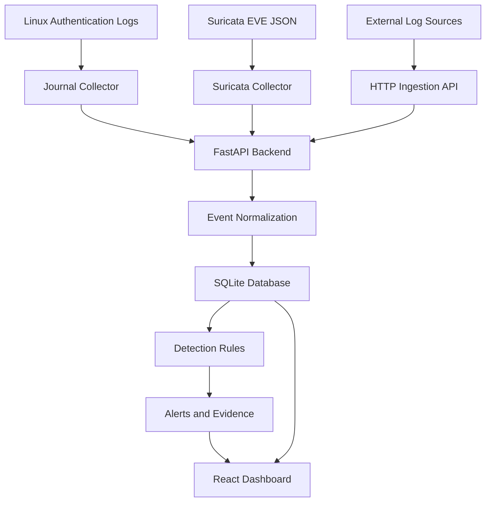

# Greywatch

**An open-source SIEM for Linux security monitoring and threat investigation.**

Greywatch collects security events, detects suspicious activity, and helps investigate potential threats through a unified dashboard. Built with Python, FastAPI, SQLite, and React, it aims to make security monitoring more accessible.

**Status:** Active development. Not yet production-ready.


## Installation

### Prerequisites

- Linux (Fedora or another compatible distribution)
- Python 3 and pip
- Node.js and npm
- Git

### 1. Clone the repository

```bash
git clone https://github.com/AnuragR3k/greywatch.git
cd greywatch
```

### 2. Set up the backend

Create and activate a Python virtual environment:

```bash
python3 -m venv .venv
source .venv/bin/activate
python -m pip install --upgrade pip
```

Install the backend dependencies using the dependency file and instructions provided in the repository.

### 3. Start the backend API

From the repository root:

```bash
uvicorn backend.app.main:app --host 127.0.0.1 --port 8000
```

Verify that the API is running:

```bash
curl http://127.0.0.1:8000/health
```

Expected response:

```json
{
  "status": "ok",
  "service": "greywatch-api",
  "version": "0.2.0"
}
```

### 4. Set up and start the frontend

Open a second terminal:

```bash
cd greywatch/frontend
npm install
npm run dev
```

Open the local URL printed by Vite in your browser.

### 5. Stop the application

Press `Ctrl+C` in each terminal running the backend or frontend.

**Note:** Check the repository's current dependency configuration for the exact backend installation command. Greywatch is under active development, so setup instructions may change.

## Features

- **HTTP event ingestion:** Accept log lines through the API and normalize supported events.
- **SSH brute-force detection:** Detect repeated failed SSH login attempts and generate alerts.
- **Alert investigation:** Review severity, source IPs, event evidence, and raw log messages.
- **Alert resolution:** Investigate and resolve alerts through the dashboard.
- **Incident correlation:** Detect SSH brute-force followed by a same-IP successful login (`SSH_BRUTE_FORCE_THEN_SUCCESS`) and manage incidents through open → acknowledge → resolved states, with related events.
- **Linux journal collector:** Optionally collect PAM, SSH, and sudo authentication events from systemd journals.
- **Suricata integration:** Optionally ingest supported EVE JSON events, including alerts, DNS, HTTP, TLS, and flow telemetry.
- **Event search:** Search and inspect collected security events.
- **Security controls:** Protect non-public API endpoints using loopback restrictions or API-token authentication.
- **Automated checks:** Backend tests, frontend linting, and production builds.

## Architecture



## Technology Stack

| Component | Technology |
|---|---|
| Backend | Python, FastAPI, Uvicorn |
| Database | SQLite |
| Frontend | React, Vite |
| Linux telemetry | systemd journal |
| Network telemetry | Suricata EVE JSON |
| Testing | pytest, frontend lint and build |
| CI | GitHub Actions |

## Collectors

### Linux systemd journal

Greywatch includes an optional collector for authentication-related events from the systemd journal, including PAM, SSH, and sudo activity.

The collector is disabled by default.

Documentation: [Journal Collector](docs/JOURNAL_COLLECTOR.md)

Endpoints:

- `GET /api/v1/journal/status`
- `POST /api/v1/journal/collect`

The collector supports one-shot execution and continuous collection. Refer to the documentation for configuration, permissions, and verification.

### Suricata EVE JSON

Greywatch includes an optional collector for Suricata EVE JSON logs. It ingests supported telemetry into Greywatch's event pipeline.

Supported event categories include alerts, DNS, HTTP, TLS, and flow events.

The collector is disabled by default.

Documentation: [Suricata Integration](docs/SURICATA.md)

Endpoints:

- `GET /api/v1/suricata/status`
- `POST /api/v1/suricata/collect`

Automated tests and fixture-based ingestion cover the integration. A complete live Suricata traffic-to-alert workflow still requires end-to-end verification.

### Incident correlation

Greywatch correlates repeated SSH authentication failures with a subsequent same-IP successful login (`SSH_BRUTE_FORCE_THEN_SUCCESS`). A correlation incident is raised per source IP when the failure threshold is met within a bounded window (default 30 minutes, configurable via `GREYWATCH_CORRELATION_WINDOW_MINUTES`). Incidents progress through `open → acknowledged → resolved` and carry the related failure and success events.

The correlation window defaults to 30 minutes and is configurable via the `GREYWATCH_CORRELATION_WINDOW_MINUTES` environment variable.

Endpoints:

- `GET /api/v1/incidents` — supports `status`, `limit` (max 500), and `offset`
  query parameters; returns `count`, `total`, and `incidents`.
- `GET /api/v1/incidents/{id}`
- `POST /api/v1/incidents/{id}/acknowledge`
- `POST /api/v1/incidents/{id}/resolve`

## API Security

Greywatch is currently designed for local or trusted-host deployments.

Only `/` and `/health` are public. All other endpoints, including read endpoints exposing raw logs and alert evidence, are protected.

### Local mode

When `GREYWATCH_API_TOKEN` is not configured, non-public endpoints accept loopback connections. Remote or unknown peers are rejected.

The API binds to `127.0.0.1:8000` by default in the documented startup command.

### Token authentication

For remote API access, configure a strong `GREYWATCH_API_TOKEN`. Protected requests must include the token using either:

```http
Authorization: Bearer YOUR_TOKEN
```

or:

```http
X-API-Key: YOUR_TOKEN
```

The supplied Caddy deployment keeps the token out of the browser and injects
it server-side as `X-Greywatch-Token` on dashboard `/api/*` requests. The
backend accepts that proxy-injected header as an equivalent shared-token
credential. Requests with missing or invalid credentials are rejected.

Agent API keys (`gw_...`) are accepted through `X-API-Key` or
`Authorization: Bearer` for `POST /api/v1/events/ingest` only. They are created
and managed through the admin agent/key endpoints and are subject to the
per-agent rate limiter. When either header carries a `gw_...` value, that agent
key is the **exclusive** credential: an invalid, expired, or revoked key
returns `401` and is never downgraded to shared-token authentication, even if
a valid shared token is also present. A valid agent key used on any other
endpoint (including `/api/v1/admin/*`) returns `403`.

See [`docs/ADMIN_API.md`](docs/ADMIN_API.md) for the full agent/API-key
administration endpoint reference, authentication rules, lifecycle procedures,
audit inspection, and security warnings.

### Request body limits

To prevent excessively large HTTP request bodies from consuming excessive
memory or resources, Greywatch enforces a configurable maximum request-body
size on every non-GET request body.

The limit is controlled by the ``GREYWATCH_MAX_REQUEST_BYTES`` environment
variable:

| Value | Behavior |
|-------|----------|
| unset | Default limit of 1 MiB (1,048,576 bytes) |
| positive integer | Custom limit in bytes |
| 0 or negative | Limit disabled (no body-size check) |
| non-numeric | Falls back to the 1 MiB default (never silently disabled) |

Requests whose body exceeds the limit are rejected with HTTP **413 Payload Too
Large** and a JSON body ``{"detail": "Request body too large"}``.

The limit is enforced against the **actual bytes received** as the request
streams in, not the ``Content-Length`` header. Missing, malformed, or
misleading length headers are handled safely: an unbounded body is never
buffered before the size check.

The limit applies to all endpoints with request bodies, including
``POST /api/v1/events/ingest``, ``POST /api/v1/journal/collect``,
``POST /api/v1/suricata/collect``, and ``POST /api/v1/alerts/{id}/close``.
GET requests and the public endpoints ``/`` and ``/health`` are unaffected.

### API rate limiting

Greywatch has three independent token-bucket limiters, all enforced in-process:

| Limiter | Applies to | Configuration |
|---------|------------|---------------|
| Pre-auth agent | Every request presenting a `gw_*` agent credential, before authentication and audit writes | `GREYWATCH_PREAUTH_RATE_*`, `GREYWATCH_TRUSTED_PROXIES` |
| Global | Every non-public HTTP route; one bucket per client identity (one shared bucket in token mode) | `GREYWATCH_RATE_LIMIT_*` |
| Per-agent | Requests authenticated with an agent API key; currently only `POST /api/v1/events/ingest` is reachable with those keys | `GREYWATCH_AGENT_RATE_*` |

All three return HTTP **429 Too Many Requests** with a numeric `Retry-After`
header. The global and per-agent limiters run after authentication, so a failed
authentication (401/403) never consumes their tokens. The pre-auth limiter runs
first and counts every agent-key attempt so that invalid-key floods cannot force
PBKDF2 work or write an `auth_failure` audit row per request. The public
endpoints `/` and `/health` are never rate limited.

Key environment variables:

| Variable | Default | Meaning |
|----------|---------|---------|
| `GREYWATCH_PREAUTH_RATE_LIMIT_ENABLED` | `1` | Pre-auth agent-key limiter on/off |
| `GREYWATCH_PREAUTH_RATE_LIMIT` | `120` | Agent-key attempts/min per client identity |
| `GREYWATCH_PREAUTH_RATE_BURST_MULTIPLIER` | `2` | Pre-auth burst = limit × multiplier |
| `GREYWATCH_PREAUTH_RATE_MAX_ENTRIES` | `10000` | Maximum identities retained (LRU eviction) |
| `GREYWATCH_TRUSTED_PROXIES` | `127.0.0.1/32,::1/128` | Peers whose forwarding headers are trusted |
| `GREYWATCH_RATE_LIMIT_ENABLED` | `1` | Global limiter on/off |
| `GREYWATCH_RATE_LIMIT_INGESTION` | `60` | req/min for `POST /api/v1/events/ingest` |
| `GREYWATCH_RATE_LIMIT_READS` | `120` | req/min for reads and other uncategorized routes |
| `GREYWATCH_RATE_LIMIT_COLLECTOR` | `30` | req/min for journal/Suricata collect endpoints |
| `GREYWATCH_RATE_LIMIT_ALERT_CLOSE` | `30` | req/min for alert close |
| `GREYWATCH_RATE_LIMIT_BURST_MULTIPLIER` | `2` | Global burst = limit × multiplier |
| `GREYWATCH_AGENT_RATE_LIMIT_ENABLED` | `1` | Per-agent limiter on/off |
| `GREYWATCH_AGENT_RATE_INGESTION` | `60` | req/min per agent for ingestion |
| `GREYWATCH_AGENT_RATE_BURST` | `1.5` | Per-agent burst multiplier |

Numeric values fall back to the documented defaults when invalid; disabling a
limiter must be explicit. See
[docs/RATE_LIMITING.md](docs/RATE_LIMITING.md) for the complete per-limiter
scope and bucket behavior.

Client identity for the pre-auth limiter is the immediate peer by default.
Forwarding headers are trusted only when the peer is in
`GREYWATCH_TRUSTED_PROXIES` (loopback by default); the supplied `Caddyfile`
sets `X-Greywatch-Client-IP` and a host-only `X-Forwarded-For` on every proxy
route.

Buckets are process-local: multiple workers or replicas enforce independent
limits, so effective limits can multiply. There is no distributed (Redis-backed)
coordination.

The per-agent `reads`, `collector`, and `alert_close` values are configurable
but are **not currently enforced**; only per-agent ingestion is active.

### Dashboard deployment

The static JavaScript dashboard cannot safely store a server-side secret. Remote dashboard access therefore requires an authentication-terminating reverse proxy and appropriate deployment configuration.

The supplied `Caddyfile` protects the dashboard shell and all dashboard `/api/*` routes with `basic_auth`, and injects `GREYWATCH_API_TOKEN` server-side in `X-Greywatch-Token`. It does not overwrite `Authorization`, so agent credentials are preserved. Dedicated routes for `POST /api/v1/events/ingest` accept remote ingestion-only agents using `X-API-Key: gw_...` or `Authorization: Bearer gw_...` without dashboard `basic_auth`; those routes do not receive the shared token. Every admin and read route remains behind dashboard `basic_auth` and is not reachable with an agent key. See [docs/DEPLOYMENT.md](docs/DEPLOYMENT.md) for the full proxy architecture and verification checklist.

Do not expose Greywatch directly to an untrusted network without deliberate authentication and network-security controls.


## Database Lifecycle Management

### Event retention

Greywatch's SQLite database grows as events are ingested. To prevent
unbounded growth, Greywatch provides a **safe, configurable event-retention
mechanism** that only removes events proven to be dispensable.

**Default behavior:** retention is **disabled** when `GREYWATCH_EVENT_RETENTION_DAYS`
is unset — nothing is ever deleted. This is the safe default; operators must
opt in by setting the variable.

When enabled, events older than `GREYWATCH_EVENT_RETENTION_DAYS` days are
**eligible** for deletion, subject to these preservation rules:

1. **Events referenced by incidents** — any event linked via `incident_events`
   (open, acknowledged, or resolved incidents) is always preserved.
2. **Evidence for open alerts** — events matching the evidence query of any
   open alert (SSH brute-force failures within the 5-minute window; Suricata
   alerts within their lifetime window) are always preserved.

If an event's relationship to forensic evidence cannot be established
safely, it is retained. **Alerts and incidents are never deleted** — only
the `events` table is pruned.

#### Configuration

| Variable | Default | Meaning |
|----------|---------|---------|
| `GREYWATCH_EVENT_RETENTION_DAYS` | unset (disabled) | Positive integer = retention period in days. `0`, negative, or non-numeric values disable retention. |
| `GREYWATCH_RETENTION_BATCH_SIZE` | `1000` | Events deleted per transaction (smaller = less lock contention). |

Invalid values (zero, negative, non-numeric) **disable** retention rather
than silently deleting everything.

#### Maintenance commands

```bash
# Preview what would be deleted (safe, read-only — default mode)
python -m backend.app.retention --dry-run

# Actually delete eligible events
python -m backend.app.retention --execute

# Compact the database after deletions (REQUIRES SERVICE DOWNTIME — see below)
python -m backend.app.retention --vacuum
```

Or via the shell wrapper:

```bash
sudo ./scripts/gw_retention.sh dry-run          # preview
sudo ./scripts/gw_retention.sh execute          # delete
sudo ./scripts/gw_retention.sh vacuum           # compact (stops prompted)
```

The dry-run output reports:
- Configured retention period
- Number of eligible events (older than the cutoff)
- Number of protected events (incident-referenced or open-alert evidence)
- Number of deletable events (eligible minus protected)

Retention uses explicit transactions with bounded deletion batches and
enables `PRAGMA foreign_keys = ON` as a safety net — any attempt to delete
an event still referenced by `incident_events` raises a hard error rather
than leaving an orphaned row.

### SQLite VACUUM (database compaction)

Deleting rows frees pages for reuse within the same table, but the database
**file size does not shrink** until `VACUUM` is run. Greywatch does **not**
run VACUUM automatically — it requires an **exclusive lock** and must be
done with the service stopped.

```bash
# 1. Stop the service
sudo systemctl stop greywatch-api

# 2. (Recommended) Take a backup first
sudo ./scripts/gw_db_backup.sh backup

# 3. Run VACUUM
sudo ./scripts/gw_retention.sh vacuum

# 4. Restart
sudo systemctl start greywatch-api
```

**Limitations:**
- VACUUM cannot run while any process holds the database open (WAL readers
  are excluded by the exclusive lock).
- Greywatch uses the default `auto_vacuum=NONE`, so incremental vacuum is
  not available; only full `VACUUM` works.
- After VACUUM, the WAL file is reset to empty and subsequent checkpoints
  start fresh.

### Backup recommendations

Always take a backup **before** running retention or VACUUM:

```bash
sudo ./scripts/gw_db_backup.sh backup
```

Backups use SQLite's online backup API (safe while the service is running)
and are verified with `integrity_check` and `foreign_key_check` before
being reported as successful. See [Database backup, restore, and disaster
recovery](docs/DEPLOYMENT.md#database-backup-restore-and-disaster-recovery).


## Testing

Run the backend tests from the repository root:

```bash
./.venv/bin/python -m pytest backend/tests -q
```

Run frontend checks:

```bash
cd frontend
npm run lint
npm run build
```

These checks validate the automated test suite and frontend code/build. They do not prove that every collector works against live telemetry.

## Current Status

### Implemented

- HTTP event ingestion and normalization
- Rule-based SSH brute-force detection
- Alert evidence and investigation
- Alert resolution
- Incident correlation and lifecycle (open → acknowledge → resolved) with related events
- Optional systemd journal collection
- Optional Suricata EVE JSON collection
- API trust-boundary enforcement
- Global and per-agent API rate limiting
- React dashboard
- Automated backend tests and frontend checks

### Work in progress

- End-to-end testing with live Suricata-generated traffic
- Additional detection rules and telemetry sources
- Further operational hardening and deployment documentation

Greywatch is evolving toward a practical, lightweight security monitoring platform. It should not yet be considered a production-ready SIEM.

## Roadmap

Potential future improvements include:

- More Linux threat-detection rules
- Additional telemetry integrations
- Better alert triage and investigation workflows
- Improved collector health visibility
- Deployment and configuration improvements
- Expanded integration and end-to-end tests

Roadmap items are not claims of existing functionality.

## Contributing

Contributions, bug reports, and feature suggestions are welcome.

1. Check existing issues before starting substantial work.
2. Open an issue to discuss larger changes.
3. Keep pull requests focused and include tests where appropriate.
4. Run the relevant backend and frontend checks before submitting.

Report bugs or suggest improvements through [GitHub Issues](https://github.com/AnuragR3k/greywatch/issues).

## License

See the repository's license file for the applicable license terms.
